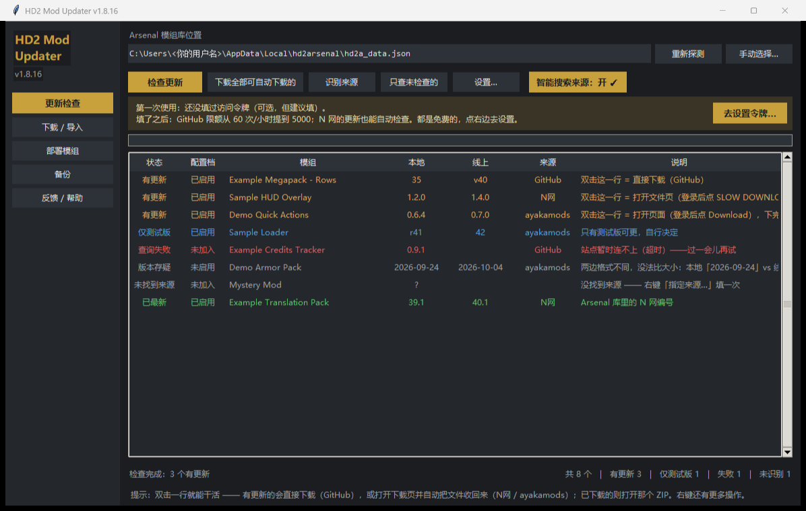
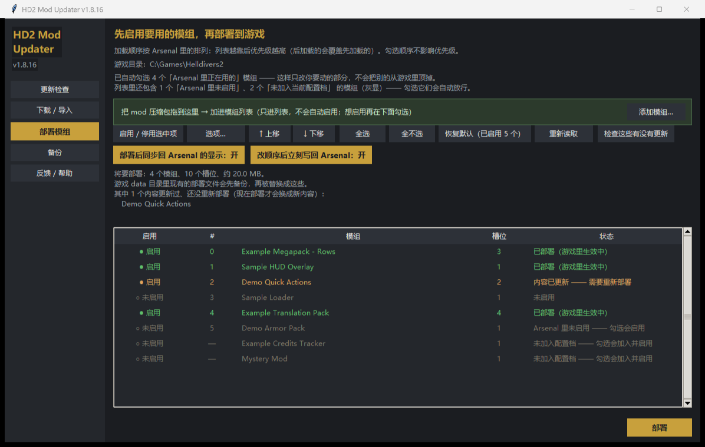

# HD2 Mod 更新管理器

给 **HD2 Arsenal** 补上它缺少的更新检测：**GitHub、Nexus、ayakamods** 三个来源统一检查，
中文界面，一键下载能自动化的部分。

## ⚠ 前置条件：需要先安装 HD2 Arsenal

**本工具不能单独使用。** 它是 HD2 Arsenal 的配套工具，不自己维护模组清单 ——
「你装了哪些 mod、哪些启用、加载顺序（优先级）」这三样都在 Arsenal 的数据文件里
（`%LOCALAPPDATA%\hd2arsenal\hd2a_data.json`），**检查更新和部署都以它为前提**。

所以在没装 Arsenal 的电脑上，本工具**启动没问题，但用不了**：没有模组清单可查、
拖入压缩包会报错、部署也会提示"没有加载顺序"。

- 已经装了 Arsenal 却提示找不到？在界面点「手动选择…」指向上面那个文件。
- 还没装？到 Nexus 搜 **HD2 Arsenal**（[mod 4664](https://www.nexusmods.com/helldivers2/mods/4664)）装好再回来。

Arsenal 只对「N 网下载的模组」查更新（详见下方原理），从 GitHub / ayakamods 手动导入的
ZIP 它永远不认识。这个工具就是补这一块——更新检查始终只读 Arsenal 的库；
**部署则是本工具自己做的**（见下方「部署模组到游戏」）。

> **English TL;DR** — A Chinese-UI companion updater for **HD2 Arsenal** (Helldivers 2).
> Arsenal only tracks updates for mods installed from Nexus; mods you grabbed from
> GitHub or ayakamods.com are invisible to it. This tool fills that gap: it auto-detects
> the Arsenal library, figures out where each mod is published, checks all three sites
> for updates, and downloads what it can. Read-only — it never modifies your Arsenal data.
> Windows 10/11, no Python needed (standalone EXE).

## 界面预览



一行一个模组，一眼看清：**本地版本 / 线上版本 / 来源站点 / 该做什么**。

---

## 为什么需要它

如果你的模组全是从 Nexus 装的，**Arsenal 自己就够了，不用装这个**。

但只要你从别处装过模组 —— GitHub 的 release、ayakamods.com 的下载页 ——
Arsenal 就永远不知道它们有新版。这个工具专门补这一块。

| | Arsenal 自带 | 本工具 |
|---|---|---|
| Nexus 来源模组 | ✅ | ✅（需自填 API key） |
| GitHub 来源模组 | ❌ | ✅ |
| ayakamods 来源模组 | ❌ | ✅ |
| 自动识别模组来自哪个站点 | ❌ | ✅ |
| 一键下载 | 仅 N 网 | GitHub 全自动；另两站半自动 |

---

## 快速开始

### 方式一：下载 EXE（推荐，免装 Python）

到 [Releases](../../releases) 下载 `HD2ModUpdater.exe`，双击即可。

> 首次运行 Windows SmartScreen 可能提示"未知发布者"（未做代码签名），
> 点「更多信息」→「仍要运行」。

### 方式二：从源码运行

需要 Python 3.9+（tkinter 随 Python 自带）：

```powershell
pip install tkinterdnd2   # 可选：装了才能"把 mod 压缩包拖进界面"
python run.py           # 打开图形界面
python run.py --check   # 命令行检查一遍
```

> `tkinterdnd2` 是**可选**依赖（tkinter 自身不支持从资源管理器拖文件）。
> 不装也能正常用，只是拖放会降级成"点「添加模组…」按钮选文件"，功能不缺。

1. 程序会自动找到 Arsenal 的模组库（找不到才让你手动选）
2. 点 **「检查更新」**
3. 有更新的会标出来；能自动下载的点 **「下载全部可自动下载的」**

### 第一次用（或换了台新电脑）

界面上会出现一条黄色提示：

> **第一次使用**：还没有识别过模组来源。点右边「开始识别来源」，
> 工具会自动找出这些模组各自在网上对应哪个页面。

点 **「开始识别来源」** 即可。它会为每个模组找出它发布在哪个网站
（GitHub / N网 / ayakamods），**结果会保存下来，以后不用重复找**。

识别完再点「检查更新」，就会去查每个网站上的最新版本。

> 「检查更新」其实也会顺带做识别 —— 但第一次用建议先单独点一次
> 「开始识别来源」，这样能清楚看到哪些模组认出来了、哪些要手动填。

### 两个按钮的分工

| 按钮 | 作用 | 什么时候点 |
|---|---|---|
| **识别来源** | 只找出"每个模组在网上对应哪个页面"，存起来 | 第一次用 / 加了新模组 / 有模组显示"未找到来源" |
| **检查更新** | 拿已知来源去各网站查最新版本 | 平时用 |

> 「重建站点索引」**平时不用点** —— 它是「识别来源」内部用的缓存机制
> （爬下 ayakamods 全部模组清单做本地匹配）。只有站点上架很多新模组、
> 导致识别不到时，才需要手动重建一次。鼠标悬停有详细说明。

### 填 Nexus API key（想要 N 网自动检查的话）

N 网要求带 key 才能查，**免费申请、个人自用是允许的**：

1. 在工具里点 **「设置…」**
2. 点 **「去获取 Nexus key」** 按钮 —— 会自动打开官方 API 页面
3. 页面上找到 **Personal API Key**，点复制
4. 粘回工具里，点 **「保存」**

> 那个按钮指向 `nexusmods.com/users/myaccount?tab=api`（Nexus 官方帮助文档里
> 指定的 API Access 页）。旁边还有「官方说明」按钮，指向其 API 使用政策。
> 没登录的话要先登录。

GitHub Token 同理 —— 设置里有两个按钮：

- **「新建 GitHub token」** → `github.com/settings/personal-access-tokens/new`
  （fine-grained，**GitHub 官方推荐**的类型）
- **「已建的令牌」** → 同一页面，用来复用已有的令牌

> 类型说明：GitHub 有 classic 与 fine-grained 两种令牌，两个页面都真实存在。
> 本工具用的是官方推荐的 fine-grained 页。权限**一个都不用勾**——
> 本工具只读公开仓库信息。

不填也能用 —— 只是 N 网模组会提示"需要设置 API key"，其余照常工作。

---

## 它能做什么

| 功能 | 说明 |
|---|---|
| **自动找到 Arsenal** | 探测 `%LOCALAPPDATA%\hd2arsenal\hd2a_data.json`，也会扫其他盘；找不到才让你选 |
| **三个站点统一检查** | GitHub / Nexus / ayakamods |
| **智能识别来源** | 替你判断每个 mod 在网上对应哪个页面，**实测算出 18/20** |
| **网站优先级** | 多平台发布时按 **GitHub > N网 > ayakamods** 取（能直连下载的优先） |
| **自动下载** | GitHub 的直链下载 + **sha256 校验** |
| **「已下载」标记** | 下过的版本标出来，不重复催、也不重复下 |
| **部署到游戏** | 侧边栏「部署模组」页：每行一个「部署 / 不部署」开关，可只放一部分；自动带入 Arsenal 在用的模组 |
| **拖入 mod 就能加进列表** | 把下载好的 mod `.zip` 拖到窗口上（或点「添加模组…」）→ 自动解包并加入模组列表；只进列表、不自动启用 |
| **删除模组** | 两个页面都支持**右键 → 删除这个模组…**；删前写清影响，要不要连磁盘文件一起删由你决定（默认不删） |
| **管理整个模组库** | 部署页列出**库里全部模组**（含未启用、未加入配置档的）；勾选「未加入」的会自动加入并启用 |
| **状态一眼可见** | 更新检查页有只读的「配置档」列（已启用 / 未启用 / 未加入），操作统一在部署页 |
| **检查在用的有没有更新** | 部署页一个按钮：只查"正在游戏里用"的那些，跳过存在电脑里没部署的，更快 |
| **选项编辑** | 每行「选项…」可勾选该模组的功能开关（如 Megapack 的 21 个）；关掉的不会被装进游戏 |
| **拖动排序** | 拖动行（或用上移/下移）改加载优先级，写回 Arsenal，写前自动备份 |
| **浏览器接力** | N网 / ayakamods 需要登录，工具开好**正确的下载页**并盯着下载夹，你点一下即可 |
| **换电脑不重填** | 数据位置可自定义到 U 盘/移动硬盘 —— 令牌、来源、索引、下载记录一起带走 |
| **手动指定来源** | 实在认不出来的，右键就能填 |
| **屏蔽某个模组的更新与查找** | 右键那一行 →「屏蔽这个模组的更新与查找」：以后**检查更新、识别来源都跳过它**（一个请求都不发）。已屏蔽的那一行右键项变成「取消屏蔽」，随时恢复。适合"我就要停在旧版"或"永远认不出来源"的那几个 |

实测抓到过的真实更新：

```
Vanilla Plus Megapack         本地 35      →  线上 v40   （GitHub 直链）
HD2Runtime                    本地 0.28.1  →  线上 v0.30.0（GitHub 直链）
中文翻译包（简体 + 繁體）        本地 39.1    →  线上 40.1  （N网，接力取文件）
```

### 一个模组在三个站点都有，会走哪一个？

**先看能不能直接下载，再看站点优先级** ← 这条规则优先于站点顺序

```
第 1 步：能不能直接下载？        GitHub 能直连下载，另两个站点必须你点一下
第 2 步：同样条件下比站点优先级   GitHub(0) > N网(1) > ayakamods(2)
```

| 情形 | 走哪一个 | 为什么 |
|---|---|---|
| 三站都有更新，GitHub 有直链 | **GitHub** | 能全自动下载，最省事 |
| 三站都有更新，都拿不到直链 | **GitHub** | 规则一致，仍按站点优先级 |
| GitHub 查询失败（限流/超时） | **N网** | 失败的来源不会被选中 |
| GitHub + N网 都失败 | **ayakamods** | 继续往下降级 |
| GitHub 已最新，但 N网 报有更新 | **N网** | 谁报更新就按谁走 |
| 三站都已最新 | **GitHub** | 只是显示"已最新"，同样优先展示它 |

> 注：**查询失败的来源永远不会被选中**（否则会把一个失败结果当成"更新"给你）。
> 三个站点是**一起查**的，所以上面这些切换不需要你额外操作，也不会重复查两遍。
>
> 另：**变体识别会再叠加一层** —— 如果你装的是 GitHub 上的 Rows 版，
> 走 GitHub 时会挑 Rows；万一某个站点上你没有那个变体，工具会说明而不是随便换。

---

## 界面说明

左侧导航一共五页：**更新检查 / 下载·导入 / 部署模组 / 备份 / 反馈·帮助**。
下面画的是最常用的前两页。

```
┌──────────┬──────────────────────────────────────────┐
│ HD2 Mod  │  Arsenal 模组库位置                        │
│ Updater  │  C:\...\hd2arsenal\hd2a_data.json [重新探测] [手动选择…]
│  v1.8.0  ├──────────────────────────────────────────┤
│          │  [检查更新] [下载全部…] [识别来源] [只查未检查的] [设置…]
│ 更新检查 │                              [智能搜索来源：开 ✓]
│ 部署模组 │  上手提示条（首次使用/有未识别时出现）        │
│          │  结果表                                    │
│          │  状态 │ 模组 │ 本地 │ 线上 │ 来源 │ 说明   │
└──────────┴──────────────────────────────────────────┘
```

**「部署模组」页**：

```
┌──────────┬──────────────────────────────────────────┐
│ 更新检查 │  选择要部署到游戏的模组                      │
│ 部署模组 │  加载顺序按 Arsenal 里的排列：越靠后优先级越高 │
│          │  已自动勾选 16 个「Arsenal 里正在用的」模组    │
│          ├──────────────────────────────────────────┤
│          │  部署 │ # │ 模组                │槽位│ 状态  │
│          │  ● 部署│ 0 │ HD2 HUD+ 简体中文    │ 1  │Arsenal 在用
│          │  ● 部署│ 3 │ Glowing Supply Icons│ 11 │Arsenal 在用
│          │  ○ 不部署│ 6│ 某模组              │ 1  │不部署
│          ├──────────────────────────────────────────┤
│          │  [部署 / 取消部署选中项] [全选] [全不选] …  │
│          │  ☑ 部署后把状态同步回 Arsenal 的显示        │
│          │  将要部署：16 个模组、49 个槽位、约 238 MB  │
│          │                                  [部署]   │
└──────────┴──────────────────────────────────────────┘
```

**状态含义**：

| 状态 | 意思 |
|---|---|
| **有更新** | 线上有正式版更新 |
| **已下载** | 这一版已经下好了，文件就在下载夹里 —— 去 Arsenal 导入即可 |
| **仅测试版** | 只有预发布版可更（带 rc/beta/Test Build），自行决定 |
| **已最新** | 无需处理 |
| **未检查** | 刚打开、还没点「检查更新」 |
| **未找到来源** | 查过了，但没认出它对应哪个页面 —— 右键「指定来源…」填一次 |
| **查询失败** | 网络问题或需要填 key |
| **版本存疑** | 版本号格式无法比较（如站点把版本写成日期），不误报 |
| **已屏蔽** | 你右键屏蔽了它：不查更新、也不找来源。右键「取消屏蔽」即可恢复 |

**双击一行** = **直接干活**（不用先想该点哪个菜单）：

| 这一行的状态 | 双击的效果 |
|---|---|
| **有更新**（GitHub，有直链） | 直接下载 |
| **有更新**（N网 / ayakamods） | 打开对应的下载页 + **开始盯着下载夹**，你点完下载，文件自动被收进工具的下载夹 |
| **已下载** | 打开那个 ZIP |
| 已最新 / 查询失败 / 版本存疑 | 打开它的发布页 |
| 未找到来源 | 打开「指定来源…」对话框 |

**右键菜单**：

| 菜单项 | 干什么 |
|---|---|
| 只检查这一个 | 只重查选中的这一条 |
| **下载 / 打开下载页（= 双击这一行）** | 和双击完全一样，给习惯用右键的人 |
| 只在浏览器打开，不自动收文件 | 只想看看页面、不想让工具盯着下载夹时用 |
| 打开已下载的文件 | 用系统默认程序打开那个 ZIP，或定位到它所在文件夹 |
| 复制链接 | 复制下载直链（没有直链时给要打开的页面地址） |
| 指定来源… | 认不出来时手填一次 |
| **撤销来源并重新识别** | 指定错了 / 站点改名了，想回到自动识别时用（手工填的那条也会一并撤掉，然后立刻重新识别这一条） |
| **屏蔽这个模组的更新与查找** | 把这一行从「检查更新 / 识别来源」里摘出去（不删模组、不影响部署）。**已经屏蔽过的，这一项写的是「取消屏蔽（恢复更新与查找）」** —— 同一项按一下就切回来 |
| 打开下载目录 | 打开工具的下载夹 |

> **指定错了怎么办**：手工指定的来源是受保护的 —— 自动识别不会覆盖它，
> 「清空来源缓存」也只清自动的。所以如果填错了，用右键的
> **「撤销来源并重新识别」** 就能把这一条彻底撤销、回到自动识别。
>
> 这个操作**不会让你丢掉手工填的地址**：撤销后如果重新识别什么也没找到
> （比如你关掉了「智能搜索来源」，或当前离线、索引还没建好），
> 原来的来源会被**自动放回去**，并明确告诉你"没找到新来源，已还原"。
> 想强行换一个来源，用右键「指定来源…」直接填新的地址就行。

**「屏蔽」是干什么的**：有些模组你就是想停在旧版（作者天天发新版，但你不跟），
或者它永远认不出来源、每次都要白跑一遍。这两种都能**逐个静音**：

- 右键那一行 →「屏蔽这个模组的更新与查找」→ 它变成「**已屏蔽**」，排在列表最后；
- 以后「检查更新」「识别来源」「下载全部」都**跳过它**（一个网络请求都不发），
  界面底部会写「已跳过 N 个已屏蔽的」；
- **不删模组、不改启用状态、不影响部署** —— 只是别再查它；
- 恢复：右键同一项，这时它写的是「**取消屏蔽（恢复更新与查找）**」；
  取消后那一行回到「未检查」，下次「检查更新」就会重新查它；
- 屏蔽期间你**主动**点它（双击那一行 / 右键「只检查这一个」），
  工具会先问一句"要取消屏蔽再做吗"，不会静默什么都不做。

**设置…** 里有 **「去获取 Nexus key」/「去获取 GitHub token」** 按钮，
一键跳到官方页面拿密钥，不用自己找入口。

---

## 部署模组到游戏

左侧导航切到 **「部署模组」** 页。勾选你想启用的模组 → 部署 → 启动游戏。

这是本工具**自己做的部署**，不走 Arsenal。



### 为什么需要它

Arsenal 只能「整包一起部署」—— 想只放一部分模组、或者临时换掉某个模组，
都做不到（改完还得整套重来）。本工具让你自己挑。

### 怎么用

1. 左侧点 **「部署模组」**
2. 列表里调勾选（**列出整个模组库**：已启用 → 未启用 → 未加入配置档）
3. 下方实时显示**将要部署多少个模组、多大体积**
4. 点「部署」，确认后完成

有三种方式切换某个模组要不要部署：

- 点该行最左的「**部署 / 不部署**」那一格
- 双击整行
- 选中后按「**部署 / 取消部署选中项**」按钮

### 改加载优先级（拖动排序）

**按住行上下拖动**即可调整顺序，或用「**↑ 上移 / ↓ 下移**」按钮微调。

默认设置下**越靠下优先级越高**（游戏后加载的会覆盖先加载的）。所以想让某个
模组赢，就把它往下拖。

改完会**自动写回 Arsenal**（关闭「改顺序后立刻写回 Arsenal」则只在本工具内预览）。

写回规则（**很重要**）：**只重排你动过的那些模组，其它模组留在原位**。

- 写前自动备份成 `hd2a_data.json.hd2u-<时间戳>.bak`
- **只动数组顺序，不改任何模组的字段**（不碰启用状态、路径、选项）
- 只会在**参与排序的模组原本占据的位置之间**互换，不会把别的模组挤走
- Arsenal 正在运行时拒绝写（它退出时会用内存状态覆盖，反而写坏）

### 编辑模组的选项

选中一行 → 点「**选项…**」。像 Arsenal 一样勾选这个模组要启用哪些功能，
比如 Vanilla Plus Megapack 有 **21 个**可单独开关的功能。

- 有父子结构的选项（如 Helmet Headlamp 的「默认模式」）会缩进显示
- **勾/取消父项会连带它的子项**；子项有开有关时父项不算全开
- 保存后会写回 Arsenal，并把它标记为「需要重新部署」—— **重新部署一次才生效**
- **被关闭的选项不会被装进游戏**（部署时按选项开关过滤）

想改回默认就再打开这个对话框勾回去。

### 删除模组

在**更新检查页或部署页**里对着要删的那一行**点右键 → 「删除这个模组…」**。

弹出的确认框会先把影响写清楚，再让你决定：

- 会**从 Arsenal 的模组列表里移除**，并**从它所在的配置档里一并移除**
  （不这么做的的话配置档会留下"僵尸条目"，那个 mod 仍可能被部署出去）
- 如果它**正被部署**：游戏里已有的文件**不会立刻消失**，要**重新部署一次**才会被清理
  （重新部署会把 data 目录里的旧 patch 清掉再写新的）
- **要不要连磁盘文件一起删**，由你当场用一个开关决定：
  - **关（默认）**：只从列表移除，文件留在磁盘上，随时可以再导入
  - **开**：连同 `mods\<名字>` 文件夹一起删掉 —— **不可恢复**（想再装得重新下载）

> 删除前会自动备份 `hd2a_data.json`（`hd2a_data.json.hd2u-<时间戳>.bak`），
> 万一删错了可以拿备份还原列表条目。
> 另外：**HD2 Arsenal 开着时不允许删除**（它退出时会用内存里的内容覆盖你的改动）。

### 把下载到的 mod 加进来：直接拖进去就行

从 Nexus / GitHub / ayakamods 下载到的 mod 压缩包，**直接拖到窗口上任何位置**即可：

1. 自动识别它是什么 mod（读包里的 `manifest.json`）
2. 解包到 Arsenal 的模组目录
3. 往模组列表里加一条 —— **只进列表，不会自动启用**

加进来之后它会在部署页显示为「**未加入当前配置档**」，你想用哪个就在那里勾选
（勾选会自动帮你加入配置档并启用），不想用就不管它。

几条要知道的：

- **同一个 mod 再拖一次 = 覆盖**（和 Arsenal 一样，它不会拦你）。旧内容会留一份
  叫 `<名字>.hd2u-old-<时间>` 的备份文件夹，确认没问题后可以自己删掉。
- **必须先完全关闭 HD2 Arsenal**（含右下角托盘图标）—— 它开着时不能改它的库，
  工具会拒绝并提示，不会硬写。
- 不是 mod 的压缩包会被明确拒绝（比如源码包、只有说明文档的包），不会有副作用。
- 一次拖多个也可以；其中一个坏的，不影响其它的。
- 如果你的环境装不了拖放组件（极少数），程序会**自动降级**：提示改成"点按钮选文件"，
  用「添加模组…」按钮一样能加，功能不缺。

> 说明：加进列表时用的是 mod 自己的 `manifest.json`（名字、描述、图标、选项都从里面读），
> 和 Arsenal 自己导入时用的信息一致。**不会**去猜 Nexus 信息，所以刚拖进来的 mod
> 在 Arsenal 里不会立刻显示"可检查 Nexus 更新"—— 需要的话还是从 Arsenal 里导入一次。

Arsenal 里已部署的模组，会**自动勾选**。这样你只改想动的部分时，
不会把其他正在用的模组从游戏里顶掉。

想整套重排就用「全不选」再自己挑；想回到默认状态点「恢复默认」。

### 列表里有三种模组，都有标记

| 状态 | 说明 | 勾选它会怎样 |
|---|---|---|
| **已启用**（在配置档里） | 正常可部署的模组 | 直接部署 |
| **未启用**（在配置档里但关了开关） | Arsenal 里显示灰显/关闭的 | 自动在 Arsenal 里**启用**，再部署 |
| **未加入当前配置档** | 只在模组库里，当前档里没有 | 自动**加入配置档并启用**（追加到末尾），再部署 |

> 「未加入当前配置档」这类模组以前在哪个页面都管不了（我们实测你库里就有 3 个）。
> 现在部署页会把它们都列出来，**不用再回 Arsenal 手动添加**。

### 加载顺序怎么算

**沿用 Arsenal 里的排列顺序，默认设置下越靠后优先级越高** —— 列表就按这个顺序列，
所以你看到的行号就是加载次序。同一模组内部的多个选项按它在包里的顺序依次排。

> 游戏按编号从小到大加载，**后加载的覆盖先加载的**，所以排在后面的赢。
> 这也是为什么 Bingus Shared Loader 这类加载器要求「放在列表最后」。
>
> 如果你在 Arsenal 里开了「第一个模组优先」，方向相反（排在前的赢），
> 工具会照做并在界面上说明。

### 选项开关也照做

模组包里的可选项（Arsenal 里能单独开关的那些）**按你当前的开关状态部署**：
禁用的选项不会被装进游戏。多选组（如 Helmet Headlamp 的默认模式）只装你选的那个。

### ⚠️ 重要：不能和 Arsenal 同时部署

两边都往游戏 data 目录写同一批 `<16位>.patch_N` 文件。Arsenal 每次部署前会
**先清空全部 patch 文件**再写自己的那套（实测日志 `Removed 136 mod file(s)`），
所以**谁后部署谁生效，之前那个的结果会被整体替换**。

请二选一：

- ✅ 用本工具部署 → 就别再点 Arsenal 的「Deploy Mods」
- ✅ 用 Arsenal 部署 → 那就当本工具的部署页没用过

工具会在部署前检测 Arsenal 是否正在运行并提醒你；正在运行时**不会**去写它的库
（它退出时会用内存里的状态覆盖，反而可能写坏）。

### 部署后 Arsenal 的显示会与实际不符

「部署后同步」默认开启，会把本次部署结果写回 Arsenal 的库，让它的「已部署」标记
与事实一致（写前自动备份 `hd2a_data.json`，原子替换，绝不改你的启用状态和顺序）。

但**这只是让显示变准，不等于两者能共存** —— 你哪天在 Arsenal 里再点一次部署，
游戏目录仍会被它重写。所以还是那句话：**固定用一个**。

### 出错了怎么办

每次部署前，游戏 data 目录里现有的部署文件都会先备份到：

```
<游戏目录>\data\hd2u_backup\<时间戳>\
```

部署完会告诉你备份在哪。要恢复就把里面的文件拷回 `data` 目录。

工具不会碰游戏本体的任何文件（`bundles.*.nxa`、散列资源文件等一律不动），
只处理模组部署文件（`<16位>.patch_N` 及其 `.gpu_resources` / `.stream` 伴生文件）。

部署失败时，报错弹窗上就有 **「生成反馈信息…」** —— 点一下会把日志和现场
一起打包，发出去我就能查（见「遇到问题怎么办」）。

---

## 「已下载」是怎么判断的

下载成功后会记一笔（`downloads.json`）：**哪个模组、哪个版本、文件在哪**。
列表里这一条就变成「已下载」，不会反复催你。

判断规则（三个条件同时满足才算已下载）：

| 情况 | 显示 | 为什么 |
|---|---|---|
| 记的版本 == 现在线上版本，且文件还在 | **已下载** | 就是刚下的那个 |
| 记的版本 ≠ 现在线上版本 | **有更新** | 线上又发新版了，不能让你以为新版本也下好了 |
| 版本对得上，但文件被移走/删了 | **有更新** + 附一句提示 | 你多半已经导入 Arsenal 了，不该继续挂着「已下载」骗人 |

「下载全部可自动下载的」也会跳过已下载的那些（按钮上会写「下载剩余 N 个」），
所以不会重复下一遍；哪天线上又更新了，它会自动重新出现。

---

## 智能识别是怎么工作的

按可信度从高到低：

1. **mod 自带 manifest 里作者写的来源** —— 最可信，直接采纳
2. **Arsenal 库里的 N 网编号** —— N 网下载的必然准确
3. **安装目录名里解析出的 N 网编号** —— 如 `Name 15298 0.2.2 2026-10-07T...`
4. **GitHub 搜索** —— 按名字搜，但要求能看出跟 HD2 有关
5. **ayakamods 本地索引** —— 爬下全站全部 mod 建索引（2026-10 实测约 870 个），模糊匹配

**最关键的消歧手段是版本号核对**：本地版本和线上版本能对上的候选，几乎必然是正确的。
例如 `Auto Reload` 会同时命中 `HD2 Auto Reload` 和 `Auto Reload Assist`，
但只有前者的版本号（0.6.4）跟本地一致，于是正确选中。

### 认不出来时怎么办

右键 → **指定来源…**，填：

| 站点 | 填什么 | 例子 |
|---|---|---|
| GitHub | 作者/仓库 | `SkyeShade/HD2Runtime` |
| Nexus | 数字 ID | `15298` |
| ayakamods | 页面地址或 slug | `https://ayakamods.com/mods/hd2runtime.4260/` |

**ayakamods 的中文 mod 也支持**：站点上约三分之一的 mod 是中文名，它们的
地址里带中文（浏览器地址栏显示成 `…/mods/机甲部位血量HUD.4775/`）。
这种地址**原样粘进来就行**，程序会自己编码；不需要你手动转成 `%E6%9C...`。

填一次就记住了。

---

## 下载说明

| 来源 | 怎么下 | 为什么不能全自动 |
|---|---|---|
| **GitHub** | ✅ **全自动**，带 sha256 校验 —— **双击那一行** | —— |
| **Nexus** | 🟡 **双击那一行** → 页面已停在那个文件上 → 点 **SLOW DOWNLOAD** | 见下 |
| **ayakamods** | 🟡 **双击那一行** → 登录后点 **Download** | 见下 |

> 双击之后你不用管了：工具会**一直盯着下载文件夹**，文件下完自动被收进工具的下载夹，
> 那一行同时变成「已下载」。（同一时间只跑一个接力 —— 双击另一行会自动让前一个让位，
> 免得两个接力抢同一个下载夹里的文件。）

### 多个「变体」怎么办（重要）

有些 mod 会**并行发布多个变体**，它们共用一个页面、共用版本号序列，但内容不同。例如
Vanilla Plus Megapack 就有普通版和 **Rows 版**：

```
Vanilla-Plus-Megapack-v40.zip          ← 普通版
Vanilla-Plus-Megapack-Rows-v35.zip     ← Rows 版（你装的是这个）
```

这种 mod 只按"最新版"来挑文件会**挑错**。本工具的做法是：

1. **认出你装的是哪个变体** —— 从安装目录名还原原始文件名
   （`Vanilla Plus Megapack - Rows 16294 35 2026-09-29T19-48Z KHd6InFpy_AR…`
   → `Vanilla Plus Megapack - Rows`）
2. **只在同一个变体里更新** —— 装 Rows 就给你 Rows，不会换成普通版
3. **变体没了就明说** —— 万一作者停更了你用的变体（比如 Rows 实际上停在 v35），
   工具**不会**偷偷把普通版塞给你，而是在那一行写上：

   > ⚠ 变体：「Vanilla Plus Megapack - Rows」停更在 v35（更新的发布里已经没有它了），
   > 这是该变体的最后一版 —— 要不要换成普通版由你决定

   换不换由你决定，工具只负责把情况说清楚。

> 认不出变体时（比如手动导入的、目录名被改过的），工具会**明确说**"认不出你装的是哪个变体，
> 默认选了最大的那个，请确认"，而不是假装知道。

### 为什么 N 网不能一键下载

实测（用自己的免费账号打 API）确认，这不是我们没做，而是**站点设计上就不允许**：

| 做法 | 结果 |
|---|---|
| 用 API key 直接取下载链接 | **HTTP 403**：<br>`You don't have permission to get download links from the API without visting nexusmods.com - this is for premium users only.` |
| 用脚本抓网页 | **HTTP 403**（Cloudflare 直接拦） |
| 手动登录后点按钮 | ✅ 可以，但免费账号要过一次等待 |

Nexus 官方 API 文档里写得很直白：

> Non-premium members must provide the key and expiry from the .nxm link provided by the website.
> ……**This ensures that all non-premium members must access the website** to download through the API.

也就是说：那个 key 是**你点了网页按钮之后，服务器才发给你的**，程序自己造不出来。
VIP（Premium）会员才能跳过这一步。

**所以本工具的做法**：

1. **双击**那一行
2. 工具打开 **`.../mods/{id}?tab=files&file_id={文件id}&nmm=1`** —— 直接落在
   **要更新的那一个文件**上，不用自己在文件列表里翻
3. 你点一下 SLOW DOWNLOAD（免费账号要等一小会儿）
4. 工具一直在盯着下载文件夹，**你点完就不用管了** —— 文件下完会自动被收进工具的下载夹，
   列表里那一条同时变成「已下载」

关于 `&nmm=1`：这是 Nexus 自己给「交给管理器下载」按钮用的参数（Vortex 生成的链接就带它）。
带上它，页面上会出现一键交给管理器处理的按钮 —— 而你的机器上 `nxm://` 协议已经指向
**HD2 Arsenal**（装 Arsenal 时就注册好了），所以这条路能直接接到你现有的管理器上。

### 关于 ayakamods

同样实测：未登录时下载按钮只是一个禁用的 `<span>`（写着 "Log in or sign up to download"），
站点**根本不把下载链接发给匿名访客**——这不是"要不要 cookie"的问题，是服务器端就不给。

所以接力时打开的是**模组页**而不是 `/download`：未登录时 `/download` 会直接甩一个 403 错误页，
容易被误会成工具坏了；模组页则会好好地显示"登录后可下载"。

本工具**不碰你的 cookie**、不保存任何站点密码 —— 你的登录态本来就在浏览器里，
工具只负责打开正确的页面、然后盯着下载文件夹收文件。

下载好的 ZIP 在 **设置… → 下载位置 → ① 工具下载夹**（默认 `%LOCALAPPDATA%\hd2-updater\downloads\`）。
装法是：Arsenal 里 `Add mods / Import` 导入 → 旧的那份禁用后删除。

---

## 为什么 Arsenal 自己做不到

解包看过它的代码，机制是：只对 `hd2a_data.json` 里 `nexusData` 非空的模组调
`api.nexusmods.com/.../files.json?category=update`。手动导入的 ZIP 没有这个字段，
所以永远不会提示更新。

它也没有第三方插件接口（应用里那个 "extension" 是**浏览器扩展**，只服务 N 网下载按钮）。
所以正确做法就是从外部补——也就是这个工具。

---

## 遇到问题怎么办

工具里有一页专门管这个：左侧 **「反馈 / 帮助」**。

### 三步把问题说清楚

1. 点 **「生成反馈信息…」**
2. 用一句话写清现象（写不清就只写现象），点 **「复制完整诊断」**
3. 把复制到的内容发出去

复制到的这段文字里已经带着我定位问题需要的东西：工具版本、Windows 版本、
有没有装 Arsenal、你的模组清单与目录名、最近做过哪些操作、三个站点通不通。
**你不用再截图，也不用回忆点了什么。**

> 从**报错弹窗**上直接点「生成反馈信息…」也行 —— 那样会自动把日志一起带上，
> 报错 / 崩溃类问题这样最省事。

### 发到哪里

| 渠道 | 适合什么情况 |
|---|---|
| [GitHub Issues](https://github.com/MiaoMiaoChongChong/HD2ModUpdater/issues/new/choose) | 首选。有模板，把诊断信息粘进第一个框就行，进度也能跟踪 |
| 小黑盒 / 贴吧 / 群里的帖子 | 没有 GitHub 账号、或者打不开 GitHub 时用这个 |

**没有 GitHub 账号**：点 **「复制短摘要（适合截图）」** ——
它生成一小段（15 行以内）关键信息，**截图发出去**就行，
比只发一张报错图有用得多。

### 日志在哪

工具会把每次检查 / 下载 / 导入 / 部署的关键步骤写进日志：

```
%LOCALAPPDATA%\hd2-updater\logs\hd2u-<日期>.log
```

保留最近 7 天，单个文件超过 2 MB 会自动轮转。
「反馈 / 帮助」页里能**直接看最近日志**、打开日志文件或所在文件夹；
也可以在「设置… → 反馈与日志」里**关掉**它（默认开启）。

### 诊断信息里有什么、没有什么

- **有**：工具版本、系统版本、Arsenal 是否找到与库文件指纹、模组清单与目录名、
  最近的操作时间线、三个站点的连通性与代理设置、你填的描述
- **没有**：你的 N网 API key、GitHub token（工具按实际值精确抹掉，**日志文件里同样不写**）；
  Windows 用户名默认也会被替换成 `<用户>`（盘符和目录结构保留，定位问题要用）
- **不上传、不联网**：诊断文本只交给你，发不发、发到哪都由你决定

生成的时候可以自己勾：要不要带模组清单、要不要带日志尾部、要不要隐藏用户名。

### 先自查一下（不少问题这里就有答案）

| 现象 | 先看这里 |
|---|---|
| 模组显示「未找到来源」 | 下面「认不出来时怎么办」 |
| 显示「查询失败」 | **双击那一行** —— 会打开说明框，写清原因并给三个出路 |
| 某一个站点的模组**整批**查不到 | 见下面「站点把我挡在门外了」 |
| 部署了但游戏里没生效 | 「部署模组到游戏」一节（顺序、启用、与 Arsenal 二选一） |
| N 网模组查不到更新 | 设置里填了 Nexus API key 吗 |
| 界面报错 / 卡住 | 点「生成反馈信息」把现场发出来 |

### 站点把我挡在门外了（a 站整批「查询失败」）

如果**同一个站点的模组整批**变成「查询失败」，而别的站点正常，那基本不是你的
网络断了，而是**站点拒绝了这台机器的自动请求**。2026-10 就出现过一次：
ayakamods 对本机出口返回 Cloudflare 的 `Attention Required / you have been
blocked`（**IP 级封锁**，实测连真实 Edge 无头浏览器都过不去）。

#### 「可我浏览器能打开啊？」—— 差在哪

这是最容易被误会成"工具坏了"的地方。差别**不在网络、不在出口 IP、也不在证书**，
而在**请求方是不是一个能跑 JavaScript 的浏览器**：

| | 你的浏览器 | 本工具 |
|---|---|---|
| 出口 IP / 线路 | 同一个代理 | **同一个**（实测同一个公网 IP） |
| 网站证书 | 正常 | **正常**（实测 SAN 就是 `ayakamods.com`） |
| 请求头（UA 等） | 浏览器 | 已用完整 Chrome UA，加 `sec-ch-ua`/`Sec-Fetch` 也一样被挡 |
| **执行 JS** | **会** —— Cloudflare 的挑战要靠 JS 算出来才放行 | **不会** —— 脚本拿到的是挑战页本身 |
| **`cf_clearance` 通行证** | **有** —— 通过挑战后站点发的 Cookie，之后一路放行 | **没有** —— 从没通过过挑战，也就拿不到这张通行证 |

所以：**同一台电脑、同一个网站、同一个出口，浏览器能进、脚本被挡**。
这不是网络故障，**也不是你的 a 站账号登录过期**（工具抓索引/查版本全程匿名，
代码里没有任何 cookie / session）。

#### 怎么办

1. **换一个代理节点**，或暂时**关掉代理**，再点右键「只检查这一个」
2. **过一会儿再试** —— 站点限流通常是暂时的
3. 点「在浏览器打开看看」：浏览器能过拦截，自己看到版本号后，
   右键「指定来源…」里把本地版本填上（工具就不必再猜）
4. 这些都不行也不影响别的：**其它站点照常工作，已识别好的来源也不会丢**

> 「反馈 / 帮助」页 →「重新检测」会把这种状态直接标成
> **「能连上，但被站点挡住」**，并在下面解释清上面这几条 —— 不用自己猜。

> 工具在「重建站点索引」抓不到东西时也会明说原因，并且**保留原有索引**，
> 不会把一份好好的索引换成空的。

---

## 「本地版本」是怎么算的？为什么它不会一直催你更新

更新检查要拿**本地版本**和**线上版本**比大小。本地版本的来源，按优先级：

1. **Arsenal 记的** `nexusData.version`（从 N 网装过的模组才有）
2. **安装目录名**里解析出来的（`<名字> <编号> <版本> <日期>T<时间>Z <随机码>`）
3. 模组目录里 `build.json` / `README` 里写的版本号
4. **你手动填的**（右键「本地版本…」）

### ★ 手动填的版本是「跟着内容走」的

有些 mod 的目录名里没有版本号，工具猜不出来，这时候你可以手工填一个。
**这个值不是永久记住的** —— 它会连同「你填的那一刻，这个模组的内容」一起记下来：

- 内容**没变** → 继续用你填的值
- 内容**变了**（说明你更新过它）→ **自动失效**，改回自动探测

> 所以不会出现「我明明更新过了，它还一直说有更新」。
> 更新检查页的「本地」那一列会标出这个值的来源：
> `1.2（自动）` / `1.1（手动）` / `1.2（旧值1.1已失效）` —— 不用再猜它凭什么这么说。

**要看清 / 改掉 / 恢复自动**：在更新检查页右键任意一行 →「本地版本…」，
那里会同时列出「现在采用的」「自动探测到的」「你手动填过的」三个值。

> 模组已经从库里删掉了、手动记录还留着？下次启动时自动清理，不会越积越多。

---

## 为什么文件夹名里的版本号有时是旧的

用本工具导入更新版时，为了不删你的旧数据，工具会**沿用原来的文件夹**。
好处是安全（旧内容会先挪到 `.hd2u-old-` 备份），代价是**文件夹名不会跟着版本变**。

所以工具判断"本地版本"时不只看文件夹名，还会看：

1. **Arsenal 记的** `nexusData.version`（从 N 网装过的才有，最准）
2. **本工具导入时记下的**版本（导入那一刻确切知道）
3. mod **自带文件**里写的版本号（`build.json` / `hd2runtime.json` 等）
4. **文件夹名**里解析出来的
5. **你手动填的**（右键「本地版本…」）

> 第 2 和第 4 条**不一致时会取更新的那个** —— 这就是为什么有些模组明明
> 文件夹名看着是旧版本，工具却能正确显示已更新。

---

## 安全与隐私

- **只读** Arsenal 的数据，绝不修改、不删除（**唯一例外是部署**：它写的是游戏 data 目录，不是 Arsenal 的库）
- **部署只写模组部署文件**（`<16位>.patch_*`），不碰游戏本体资源，部署前必先备份
- **不碰** 浏览器 cookie、不存任何站点密码
- API key 存在本机 `%LOCALAPPDATA%\hd2-updater\config.json`，只用于发查询请求
- 下载 GitHub 文件时**校验 sha256**（与官方发布的一致才保留）
- 对 ayakamods 做了请求节流（同站点间隔 3 秒），不给站点添麻烦

---

## 命令行模式

```powershell
python run.py --check          # 不开窗口检查一遍
python run.py --check --all    # 连已最新的也列出来
```

退出码：`0` = 没有更新，`1` = 有更新，`2` = 出错。

---

## 文件位置

| 内容 | 位置 |
|---|---|
| 配置（Arsenal 路径 / 令牌 / 版本修正 / 各类路径） | `%LOCALAPPDATA%\hd2-updater\config.json` |
| 已确认的来源 | `%LOCALAPPDATA%\hd2-updater\sources.json` |
| ayakamods 索引 | `%LOCALAPPDATA%\hd2-updater\ayaka_index.json` |
| **下载记录**（哪个模组下了哪一版、文件在哪） | `%LOCALAPPDATA%\hd2-updater\downloads.json` |
| 下载的 ZIP | `%LOCALAPPDATA%\hd2-updater\downloads\` |
| **日志**（排查问题用，保留 7 天，可在设置里关） | `%LOCALAPPDATA%\hd2-updater\logs\hd2u-<日期>.log` |

上面这些**都可以换地方**（设置… → 数据位置 / 下载位置），想在别的机器上带着走很省事。
确认要重新识别所有来源：**设置… → 清空来源缓存**（不会动手工指定的那些）。

---

## 已知限制

1. **ayakamods 靠爬网页**（站点没开放 API，搜索页还对脚本返回 403），靠列表页建索引。
   站点改版就可能失效，出错信息会直接显示出来。
2. **N 网 / ayakamods 不能一键下载**（站点设计如此，Premium 会员才可以），
   走"浏览器接力"：工具开对页面 + 盯着下载夹，你点一下下载即可。
3. **N 网必须填 key** 才能自动检查，这是 Nexus 的限制。
4. **GitHub 未登录限额 60 次/小时**；可在设置里填 token 提到 5000。
   超出会自动退回 `releases.atom`（只有版本号，没有下载直链）。
5. **日期 vs 版本号**：ayakamods 上有些模组的"版本"栏填的是日期
   （如 `2026-09-24`）。这种情况版本无法比较，会显示"版本存疑"而**不会**误报有更新。
   只有本地版本和线上版本能用 `same`/`older` 对上的候选，才会被标为"版本号已核对一致"；
   仅仅是"线上有更新的版本"属于弱线索，不会被说成已核对。
6. **少数 mod 认不出来**（实测 20 个里有 1~2 个），右键手动指定即可；
   指定错了可以用右键「撤销来源并重新识别」退回来。
7. **「已下载」只是引用，不搬运**：你把下载夹里的 ZIP 移走/删掉后，
   那一行会退回「有更新」并附一句提示 —— 这是故意的，避免误以为新版已就绪。
8. **ayakamods 的中文地址**：中文 mod 的页面地址里含中文，粘进
   「指定来源…」时**原样粘贴即可**（不用自己转码）。
9. **部署不能和 Arsenal 并存** —— 两边写同一批文件，会互相覆盖。请二选一
   （详见上方「部署模组到游戏」）。
10. **部署只复制文件，不做合并**：Arsenal 会把一个模组的多个选项合并成更少的
    二进制 patch，本工具则一个选项一个文件地原样部署，所以**部署后的文件个数会变多**。
    这是刻意的 —— 游戏按序号决定加载先后，拆开反而更可控。
11. **只能在 Arsenal 里启用的模组才能部署**：没启用/不在当前配置档的模组没有加载
    顺序，工具会直接提示你去 Arsenal 里启用，不猜。

---

## 环境要求

- Windows 10 / 11（64 位）
- **用 EXE 不需要 Python**；从源码跑需要 Python 3.9+（tkinter 随 Python 自带）

自己打包 EXE（用 PyInstaller）：

```powershell
pip install pyinstaller
python build_exe.py      # 产物在 dist\HD2ModUpdater.exe
```

---

## 开发

```
hd2_updater/
  util.py       HTTP（重试/节流）、版本比较、错误翻译、数据目录管理
  arsenal.py    定位并只读 Arsenal 库、猜版本、还原变体名、读 manifest 来源
  deploy.py     部署到游戏：算加载优先级、备份、复制 patch 文件（唯一写游戏目录的地方）
  arsenal_sync.py 与 Arsenal 同步：镜像接管（读已部署的）、写回状态、运行时冲突检测
  providers.py  github_check / nexus_check / ayaka_check / ayaka_crawl、网址识别
  matcher.py    搜索词生成、相似度、来源识别、版本核对消歧
  engine.py     Engine：解析来源 → 检查 → 汇总；下载
  records.py    下载记录（哪个模组下了哪一版、文件在哪）
  gui.py        中文 tkinter 界面
  cli.py        命令行模式
tools/
  check_names.py          静态检查「用了但没定义」的名字
  check_display_text.py   静态检查用户可见文案里残留的 markdown `**`
tests/
  run_all.py              一条命令跑全部检查 + 测试
  test_fixes.py           离线测试：中文来源、撤销来源、相似度不误配、索引格式
  test_gui_undo.py        界面测试：右键「撤销来源并重新识别」全流程
  test_block.py           离线+界面测试：屏蔽模组（检查更新/识别来源都跳过、右键开关）
  test_config_safety.py   离线测试：config.json 的原子写、读坏了不能把 key 抹掉
  test_checker_negative.py 负向验证：检查脚本自己能不能抓到问题
  test_live_ayaka.py      联网端到端（重建索引 + 真实爬页面 + 真实匹配）
  test_diag.py            离线+界面测试：反馈 / 诊断（日志、脱敏、报告、入口）
  fixtures/               真实页面 HTML（离线测试用，不联网）
run.py          入口
```

改动后自测：

```powershell
python tests/run_all.py                  # 全部静态检查 + 离线/界面测试（秒级）
python tests/test_live_ayaka.py          # 联网端到端（约 3~5 分钟，会真爬 44 页）
python run.py --check                    # 命令行跑一遍
```

> 测试都跑在临时的数据目录里（`HD2U_DATA_DIR`），**不会动你的真实配置和来源表**。


欢迎提 issue / PR。改动请尽量保持「只读 Arsenal」这一条底线。

---

---

## 更新日志

> 按版本倒序。**新用户不必读这一节** —— 上面「快速开始」「界面说明」已经够用了；
> 这里只回答"某个版本改了什么"。

> **v1.8.16 新增：把不想跟的模组「屏蔽」掉**
> 右键任意一行 →「**屏蔽这个模组的更新与查找**」：以后「检查更新」「识别来源」
> 「下载全部」都跳过它，一条请求都不发，列表里那一行显示「已屏蔽」、排在最后。
>
> · 适合两类情况：**你就是想停在旧版**的模组；**永远认不出来源**、每次白跑的那些。
> · **不删模组、不改启用、不影响部署** —— 只是别再查它。
> · 已屏蔽的那一行，右键同一项会变成「**取消屏蔽（恢复更新与查找）**」，按一下就回来；
>   取消后它回到「未检查」，下次检查会重新查。
> · 屏蔽期间你**主动**点它（双击 / 右键「只检查这一个」），会先问一句要不要取消屏蔽，
>   不会静默没反应。
> · **更新检查页和部署页的右键菜单都有这一项**，两处行为完全一样；
>   部署页的「状态」列也会标出「更新已屏蔽」，免得你在那一页纳闷它为什么不提示更新。
> · 反馈/诊断信息里的模组清单会写明哪些被屏蔽了。

> **v1.8.15 修复：让「以前填过版本号」的老用户真正好起来**
> 上面 v1.8.12 把根因修掉了（手动填的版本会跟着内容走、内容一变就失效），
> 但发布前复核发现：**光升级，问题不会自己好** ——
> 以前填过的那些记录**没有"内容"信息**，工具出于"不删用户数据"的考虑原样沿用，
> 于是它们**永远不过期**，你还是会看到「装了新版还说有更新」。
>
> 这一版把最后一步补上：
> 1. **启动时自动清掉「没有影响」的老记录** ——
>    你填的值和自动探测到的**完全一样**时，有它没它结论一模一样，属于纯噪音，直接清掉。
>    实测反馈者那 16 条里 **13 条**属于这类（他完全不用管）。
>    你填的值**确实和自动探测不同**、或**自动探测不出版本号**（这时你填的值是
>    唯一能比大小的依据）→ 一律保留，交给你确认。
> 2. **那个弹窗改好了** —— 以前按【否】时输入框预填的就是那条可疑的旧值，
>    不清楚情况直接回车会把错值又存一遍（**比不按更糟**）。
>    现在「确实有问题」时**默认按钮就是「恢复自动探测」**（直接回车即修好），
>    文案里也写明「← 直接回车就是这一项」；一切正常时默认【否】（什么都不做）；
>    **自动探测不出版本号时不推荐你清**（那会删掉唯一的依据），默认【否】保持不动。
> 3. **「说明」列写明了按哪个键** —— 以前只写「不可清除」，没说按哪个键，
>    你很可能按错；现在写的是「右键『本地版本…』**选【是】**即可恢复自动」。
>
> **你该怎么做**：升级后正常启动一次（无影响的那些会自己清掉）；
> 若仍有模组显示「有更新」，看「说明」列里写着「还没和当前内容核对过」的那些，
> **右键那一行 →「本地版本…」→ 直接回车**即可。只剩个位数条。

> **v1.8.14 修复：N 网已删除的 mod 被说成「你没填 API key」**
> 你报的：「这里有个在 N 网已经被删除的 mod，之前一直显示的是此 Mod 已被删除无法查看
> 之类的，现在直接显示我没有填 API 了，但实际上我填入了 API，这可能会误导用户」。
>
> **原因**：错误分类是靠"在错误文案里找关键字"做的，而 N 网对已删除的 mod 给的文案是
> 「这个 mod 被**隐藏/删除**，或你的 key 无权访问」—— 分类时找的是"被删除"三个字
> （文案里没有），于是那条分支**从来没生效过**，继续往下落到了跟"钥匙"有关的那一条 →
> 显示成「需要 API key」。**你填了也没用，因为它压根不是在说 key。**
>
> 这版把分类方式整个换了：
> 1. **失败原因由产生它的地方打标签**（`gone` / `site` / `net` / `rate` /
>    `no_key` / `bad_key` / `noperm` / `shape`），界面只认这个标签，
>    **不再匹配文案** —— 以后改文案不会再让分类静默失效。
> 2. **分支顺序按"你下一步该干什么"排**：先判「这个 mod 没了 / 站点不让查」，
>    最后才判凭据问题。以前凭据那条排得靠前，会把前者全吃掉。
> 3. **区分「没填 key」和「key 无效」**：前者提示去填，后者提示去换一个 ——
>    以前两种都说成"需要 API key"，你会拿着一个明明填着的框反复确认。
>
> 实测（带真实 key）：已删除的 mod（如 #17024）现在显示
> **「这个 mod 在站上已经没有了（可能已删除/改名）」**。

> **v1.8.13 修复：更新并**导入**了模组，仍然一直说「有更新」（v1.8.12 没覆盖到）**
> 你报的：「我自己用着有问题，两个 mod，runtime 和 Vanilla Plus Megapack - v41，
> 我明明更新了也导入部署了，但是现在重新检查还是显示有更新」。
>
> **原因**：和 v1.8.12 那个不是同一个问题。导入更新版时，为了不删你的旧数据，
> 工具会**沿用原来的文件夹** —— 于是文件夹名里那个版本号就成了**永久的旧值**
> （`Vanilla-Plus-Megapack-v40` 里装着 v41 的内容）。而本地版本是从文件夹名读的，
> 于是永远读到 40。
>
> 这版改了两处：
> 1. **导入那一刻就把「现在装的是哪个版本」记下来**（连同当时的内容）。
>    导入是我们最确切知道版本的时刻，比事后从文件夹名或 mod 自带文件里猜可靠得多。
>    以后你用本工具导入更新版，本地版本会立刻跟上。
> 2. **存量兜底**：文件夹名和 mod 自带文件里写的版本号**不一致时，取更新的那个**。
>    所以这一版你**不用重新导入** —— 已经中招的模组装上就会自己好起来。
>
> > 顺带说明：`机器部位血量HUD v1.11.1` 那个显示成 `1` 是**正常的** ——
> > 那个 mod 在 N 网上登记的版本号就是 `1`，`v1.11.1` 是作者写在 mod 名字里的。

> **v1.8.12 修复：「我明明更新过了，它还一直说有更新」（issue #1）**
> 你报的：「更新信息有误」「重新下载mod并安装」。
>
> **根因**：以前你手工填过的本地版本会被**永久**记住，而且优先级最高 ——
> 它压过了所有能从磁盘上读出来的新证据。你当时填的是 1.1，后来模组更新成 1.2 了，
> 那个 1.1 还是排在最前面，于是工具拿它去比线上版本，一直报「有更新」。
> 你重装多少次都没用 —— 而且**界面上完全看不出来**那个数字是手动填的。
>
> 这版改了三处：
> 1. **手动填的版本改成「跟着内容走」**：它会连同"你填的那一刻这个模组的内容"
>    一起记下来。内容没变就继续用；**内容变了（你更新过它）就自动失效**，
>    改回自动探测。以后不会再出现"更新完了还一直催你更新"。
> 2. **界面如实标出这个值从哪来**：「本地」列会写 `1.2（自动）` /
>    `1.1（手动）` / `1.2（旧值1.1已失效）`。说明里也会讲清为什么这么判。
>    另外右键多了一项「本地版本…」，那里同时列出「现在采用的」「自动探测到的」
>    「你手动填过的」三个值，可以改、可以一键恢复自动探测。
> 3. **修两个会让人白折腾的毛病**：
>    · 只打开「指定来源」改来源、版本框一字未动时，**不再**把你的版本号冻住
>      （以前是每次保存都顺手写一条）；
>    · 把下载好的 ZIP 拖进来导入时，**不再抹掉 Arsenal 自己记的模组信息**
>      （那会让工具在"刚装完新版"的情况下仍说有更新）。
>    · 模组已从库里删除、留下的手动记录会自动清理。
>
> 旧的（没有内容签名的）手动记录**不会被丢弃**，仍然照用，但会在界面上标成
> 「还没核对过内容」，你可以自己决定要不要改回自动。

> **v1.8.11 修复：来源总览里「重新查找」查到了却不显示（v1.8.10 没修到底）**
> 你报的：「我用 Diver's Best Friend 这个 mod 尝试，来源总览里重新查找只是显示
> 已经重新查找，**结果是什么也没显示，明明 GitHub 有这个模组也还是没找到**」——
> **是我的 bug，而且 v1.8.10 只修了"显示同步"那一半，没修到根子上。**
>
> 真正的根因有两条，都在"数据"这一层，不在显示层：
>
> 1. **重查结果根本没写进磁盘。** 来源表的保存规则是"盘上已有的模组一律跳过"
>    （本意是保护你手工填的来源），而你在「来源总览」里重查的那条 mod
>    **本来就在盘上**（它有 a 站来源）—— 于是新认出来的 GitHub 被这条规则挡掉。
>    日志里明明写着"查到 1 个候选"，磁盘上却还是原来那一条。
>    现在：**显式重查过的条目照写不误**（同一站点用新结果替换，其它站点原样保留，
>    你手工指定的记录仍然受保护、不会被降级）。
> 2. **同一个来源被拆成两行。** 盘上的记录没有版本字段，而查询结果有 ——
>    老代码按「站点+版本」去重，于是同一条 GitHub 显示成
>    「找到（还没查版本）」**和**「找到 r42」两行，看着像没找到。
>    现在按「站点 + 地址」归组：同一条只出现一次，并且**带上查到的版本**；
>    GitHub 真有正式版 + 测试版两个时，它们仍然各自成行、各有一个下载按钮。
>
> 顺带两处：
> - **重查时顺手把版本也查了** —— 以前点完只显示"找到（还没查版本）"，
>   你还是不知道线上是什么版本。
> - **完成提示改成如实报结果**，不再只说"已重新查找"：采用了就说新条数；
>   **查到了但可信度不够、没敢替你采用时会明说**（并指路「手工指定来源…」）；
>   一个候选都没有才说"这次没找到"。
>
> ⚠ 一条红线没放宽：**可信度不够的匹配（medium/low）依然绝不写进来源表** ——
> 否则会固化成错误的"已确认来源"，下次拿它去比版本，把你引到别的 mod 页面上。
>
> **v1.8.10 修复：来源总览里「上面说没找到、下面显示找到了」**
> 你报的：「在来源查找界面，下面显示已找到了，但是上面还是显示的没找到，
> 是不是没做同步？」—— **是的，没做同步，我的 bug**：
> 顶部那句「当前结论」是打开这个框时**一次性写死**的静态文字，而重查只重画了
> 下面三行，于是上下自相矛盾。
>
> 现在：① 顶部改用可变文本，重查完**跟着重算**；② 重算**不再照抄旧的 status**
> （那个值可能已经过期），而是**直接按当前来源与版本算** ——
> 一条来源都没有才说「没找到来源」；有来源就报「已找到来源（线上 X）」；
> ③ 重查完还会用新来源**重算这一行在列表里的状态**，所以框里和列表里也一致了。
>
> ※ 但 v1.8.10 **没修到根子上**：那次只让"显示"同步了，而重查结果压根没落盘
> （见上面 v1.8.11）。所以当时你看到的现象会以另一种形式回来 ——
> 这条记录留在文档里，是为了说明"改了显示层不等于改了数据层"。
>
> **v1.8.9 改进：来源总览改成「三个站点固定三行 + 单独查找」**
> 你的反馈（附截图）：「来源总览里面要不直接改成三个来源，然后后面写是否找到，
> 然后可以单独查找某一个来源或者全部重新查找这样，给更多可以操控的地方，
> **现在里面就一个莫名其妙的空白窗和几行字**」—— 都对，尤其那个空白窗是**我的
> bug**（上一版改成总览时忘了删旧的大文本框，它已经不往里写内容了）。
>
> 现在这一页长这样（**固定三行**，不随结果增减）：
>
> | 站点 | 显示 | 操作 |
> |---|---|---|
> | **GitHub** | 找到 r41（正式版）/ 找到 r42-ui-recovery-test（测试版） | 下载 r41 · 下载 r42… |
> | **N网** | 没找到（可以点右边单独再查一次） | 只查这个 |
> | **ayakamods** | 找到 42 - UI Recovery (Test Build)（测试版） | 打开页面 · 只查这个 |
>
> 底部还有「**全部重新查找**」和「手工指定来源…」。
>
> **为什么固定三行比"只列找到的"好**：只列找到的，你就看不出**哪个站点没找到**
> —— 分不清是"没找到"还是"没查"。现在「没找到」会明说。
> 「只查这个」只重查那一个站点，**别的站点不受影响、已找到的来源也不会丢**。
>
> **v1.8.8 改进：「来源总览」—— 一个 mod 的全部来源，想用哪个点哪个**
> 你的提议（我采纳了）：「是不是这一行怎么回事这个选项不太好适配？要是不好适配
> 要不直接改成**来源总览**，显示该 mod 的全部来源？然后玩家可以自己根据来源去
> 下载（a网和n网的都是打开，GitHub是下载，和列表里差不多）」
>
> 这个提议更好，因为原来的框是"解释型"的（按状态写不同的说辞：为什么查不到 /
> 为什么显示测试版），既啰嗦又容易跟你实际想问的错位。现在改成**来源总览**：
> 不管那一行是什么状态，看到的都是同一件有用的事 ——
>
> | 显示 | 按钮 |
> |---|---|
> | `GitHub：r41（正式版）` | **下载 r41** |
> | `GitHub：r42-ui-recovery-test（测试版）` | **下载 r42-ui-recovery-test** |
> | `ayakamods：42 - UI Recovery (Test Build)（测试版）` | **打开页面** |
>
> 动作与列表里完全一致：GitHub 有直链→**直接下载**；N网 / a 站→**打开页面**，
> 并把下好的文件自动收回工具的下载夹。右键任意一行 →「**来源总览…**」打开。
> 按钮上带版本号，同一个站点有正式版+测试版两条时也能分清。
>
> ★ 顺带说明你上一轮看到的那段"接下来可以（按推荐顺序）"：那是**「查询失败」
> 那一行**的说明（你当时右键的应该是某个查失败的行，不是 Diver's Best Friend
> 那行 —— 那行是「仅测试版」，说明框内容不同）。现在两者统一成来源总览，
> 不会再出现"看到的解释跟想问的对不上"。
>
> ★ 还有一个**根因**顺带查清了：为什么 v1.8.7 之后 Diver's Best Friend 仍显示
> a 站 —— 因为它的来源**早就被保存在 `sources.json` 里了**（只存了 a 站一条），
> 而「检查更新」只用已保存的来源、**不会重新跑一遍识别**。想让它认到 GitHub，
> 需要点「识别来源」（或在「来源总览」里看到后手工指定）—— 现在来源总览会
> 把已保存的来源与本次查询结果**合并展示**，你能直接看到手上到底有哪些来源。
>
> **v1.8.7 修复：GitHub 的预发布版看不到（我上一版的说法是错的）**
> 你的质疑是对的：「既然 GitHub 上 `r42-ui-recovery-test` 的 `prerelease=True`、
> a 站也是 r42 测试版，那不应该优先在 GitHub 上下载吗？」
> **根因是我的 bug**：`github_check` 原来读 `/releases/latest`，而 GitHub 官方
> 语义是 "latest = 最新的**非** prerelease、非 draft 发布" —— 也就是
> **latest 明确跳过预发布版**。实测本仓库：`/releases/latest` 只返回 `r41`，
> 而 `/releases` 列表里明明有 `r42-ui-recovery-test`（prerelease=True）。
> 于是工具**根本看不到** GitHub 的 r42，才显示成"只有 a 站有测试版更新" ——
> 上一版我解释成"GitHub 没有更新的正式版，所以显示 a 站"，**那个解释是错的**，
> 真正的错在读取端点。
>
> 修法：① 改读 `/releases?per_page=15`（一次拿到全部，含 prerelease），
> 仍按"正式版优先"挑主结果（这样"已最新"的判定不被测试版干扰）；
> ② 若仓库里还有一个**更新的预发布版**，额外产出一条标着 prerelease 的候选，
> 让它在"仅测试版"这一档正常参与比较。实测修完：GitHub 的 `r42` 进入候选，
> 按优先级 `github > ayakamods` **优先显示 GitHub**（并带下载直链）。
>
> **v1.8.6 改进：把「为什么这一行显示的是这个来源」摊开给你看**
> 你问的：「是不是因为 GitHub 还没检测 Pre-release，我现在检查更新开始显示
> 来源是 a 站，这个是对的吗？」—— 当时我答"是对的"，**但 v1.8.7 查出那个
> 结论建立在错误的读取端点上**（详见上一段：GitHub 的预发布版其实没被读到）。
> 下面这半段仍然成立，是"如果各来源确实都读到了，该怎么解释"：
>
> 工具**优先报正式版更新**；只有在"没有正式版更新、而某来源有更新的测试版"时
> 才显示「仅测试版」。界面右侧那个说明入口仍然有用 —— 它会摊开每个来源
> 各查到的版本与性质，让你不必来问。
> 另外：**GitHub 的 Pre-release 标记是被识别的** —— 作者标了 `prerelease`、
> 或版本名里带 `test`/`beta`/`rc` 之类字样，都会被当成测试版，不会冒充正式版
> （实测：GitHub 上 `r42-ui-recovery-test` 的 `prerelease=True` 被正确读到）。
>
> 现在你能自己看到这些：右键任意一行 →「**这一行是怎么回事…（各来源查到什么）**」，
> 里面列出**每个来源各查到的版本与性质**、为什么显示的是测试版那一行、
> 以及要不要更的判断提示。表格「说明」列也会补一句
> 「（其它来源也查过，无正式版更新）」，一眼就知道不是"没查 GitHub"。
>
> **v1.8.5 修复：GitHub 上有仓库却认不出来（搜索词少了"紧凑形式"）**
> 你问的：「https://github.com/HWG90/DiversBestFriend 这个模组在 GitHub 上也有，
> 但是有些搜出来的是 A 站的，是因为 A 站的名字更贴近，GitHub 的名字差的较远吗？」
> —— 查下来**不是名字贴近的问题，是我漏了一种搜索词形态**：
> **GitHub 搜索是按词 AND 匹配的**，多词组合经常直接 0 结果。实测这个 mod：
>
> | 工具实际搜的词 | GitHub 结果 |
> |---|---|
> | `DiversBestFriend R41 MissionBlacklist` | **0 个** |
> | `Diver's Best Friend Automated Stratagem System` | **0 个** |
> | `DiversBestFriend R41` | **0 个** |
> | `DiversBestFriend`（**连写形式**，原来没搜过） | ★ **命中 `HWG90/DiversBestFriend`，相似度 100%** |
>
> 也就是说 GitHub 这条路**等于白跑了**，于是只剩 a 站的候选 —— 看起来就像
> "A 站名字更贴近"。现在搜索词**第一位就是连写形式**（`DiversBestFriend`），
> 实测已能识别出 GitHub 来源（相似度 100%、HD2 证据 1）。
> 同时收紧了两个坑：**单字词**（如 `Diver's`，会返回 10 个无关仓库）和
> **超长连写**（如 `ResupplyBoxesEmissive`，GitHub 搜不出东西）不再占用配额。
>
> ★ 附带说明你截图里那行「仅测试版」：那个 mod 你装的是 GitHub 的正式版
> `r41`，而 a 站上更新的是 `R42 - UI Recovery (Test Build)`（测试版）——
> 所以工具**正确地**显示"只有测试版可更，自行决定"。修好搜索后，GitHub 来源
> 也会一并列出来（它的正式版与本地同版本 = 无更新）。
>
> **v1.8.4 修复：网络自检报假警（N 网明明能查却显示"被挡"）+ 代理说明**
> 你报的：「我的N网似乎一直都是显示能连上但是被挡？明明更新里确实能查到是最新」
> —— 这是**我的 bug**：自检探的是 `www.nexusmods.com`（**网页版**，吃
> Cloudflare，脚本必被挡），而工具查更新真正走的是 `api.nexusmods.com`
> （**API**，一直正常）。探错了入口，就会报一个假警。
> 现在自检**一律探"工具实际用的那条路"**：N 网走官方 API（并带上你自己的
> key）、GitHub 走 API、a 站探列表页（爬索引实际走的那条，而不是首页）。
> 实测同一时刻：网页版 403 挑战页、API 正常返回、`nexus_check` 成功查到
> `0.36.2` —— 修好后自检显示「正常」，与"能不能查到更新"一致了。
> 另外：N 网没填 key 时，API 回 401 现在说成「能连上（API 返回 401：没填
> N网 key，填上就能查 N 网更新）」，而不是含糊的"可能被拦截"。
>
> **关于代理**（你问「检测到我 VPN 的端口，那别的用户端口不一样也能用吧？」）：
> **能用，工具不写死端口**。实测源码里没有任何硬编码代理端口，代理一律取自
> `urllib.request.getproxies()`（Windows 上它会读系统代理设置 —— 我把环境变量
> 清空后复测，仍能读到系统代理）；任何 VPN 客户端的端口都会被自动采用，
> 完全不挂代理（直连）也能用。自检里现在显示成
> 「走代理 http://127.0.0.1:xxxx（**工具实际用的出口**）」——把与本工具无关的
> ftp 噪音去掉了，一眼能确认工具确实走了你的代理。
>
> **v1.8.3 说明：把「浏览器能开、工具却被挡」讲清楚**
> 你问的「既然我浏览器能正常访问，为什么我这个软件没法正常访问？直接有什么
> 区别？」—— 我把差异逐层测了一遍，结论是**差别不在网络、不在出口 IP、也不在
> 证书**（实测同一个公网出口 IP、a 站证书 SAN 就是 `ayakamods.com`），
> 而在**请求方是不是一个能跑 JavaScript 的浏览器**：Cloudflare 的挑战要靠 JS
> 算出来才放行，浏览器会算、还能留下 `cf_clearance` 通行证；脚本不会算，
> 拿到的永远是挑战页。**同一台机器、同一个网站，浏览器能进、脚本被挡**。
> 所以：① 「反馈 / 帮助」页的「重新检测」现在会把这种状态直接标成
> **「能连上，但被站点挡住」**，并解释清上面这几条；② 诊断报告里也写了同样
> 的解释；③ README 补了对照表。**这不是网络故障，也不是你的登录过期**
> （工具全程匿名，代码里没有任何 cookie / session）。
>
> **v1.8.2 修复：设置页"下半截滚不动" + 重建索引"看起来没生效"**
> ① **设置页只有上半能滚**（你报的）：两个密钥输入区块（N网 key / GitHub token）
>    的父容器写死了对话框本体，跑到滚动区外面去了，所以怎么滚都够不到。
>    现在它们和其它区块一样在滚动区里 —— 8 个输入控件全部可滚到。
> ② **点「重建站点索引」看起来没反应**（你报的）：抓取一条都没成功时，
>    工具会保留原索引（这是对的，避免把 902 条的好索引换成空的），但完成提示
>    写的是"已抓取 902 个模组"，而设置页那行仍显示"1 天前更新" —— 看着像
>    按钮没生效。现在改成：**没抓到就明确说"索引没能更新、原索引已保留"**，
>    并说清原因；真写成功了才报成功。设置页那行状态也会**重建完就地刷新**。
> ③ **顺便回答一个容易误判的点**：这不是"你的 a 站登录过期"。
>    工具抓索引是**匿名**的，全程不使用你的 a 站账号（代码里没有任何
>    cookie/session）；浏览器能登录进去，是因为浏览器能过站点的自动请求拦截，
>    而脚本会被挡。这条已经写进提示里，免得你往那个方向排查。
>
> **v1.8.1 修复：设置页能滚动了 + 「查不到」时给出路**
> ① **设置页以前显示不全** —— 内容一路加下来（密钥 / 下载位置 / 数据位置 /
>    备份保留 / 维护 / 反馈与日志），窗口又是按内容高度撑的，撑到屏幕边缘
>    之后最后几段就永远看不见。现在内容区**可上下滚动**（滚轮或右侧滚动条），
>    底部「全部保存并关闭」固定在窗口底部、滚到哪儿都按得到；窗口也能自己拉大。
> ② **「查询失败」不再是一句含糊的报错**：双击那一行会打开说明框，写清是
>    「站点挡住了自动查询」还是「这个页面不存在了」，并给三个当场能点的出路
>    （浏览器打开看看 / 指定来源… / 只重查这一个）；右键也有同一入口。
>    表格「说明」列压成一句话，一眼能分清这两种完全不同的情况。
> ③ **站点整批查不到时，工具会说清原因**：2026-10 实测 a 站对本机出口返回
>    Cloudflare 的 `Attention Required / you have been blocked`（IP 级封锁，
>    连真实 Edge 无头浏览器都过不去）。这类情况以前报「可能是 Cloudflare 拦截
>    或需要登录」，用户不知道该干嘛；现在明确写「不是你的网络断了」并给出
>    「换代理节点 / 关掉代理 → 过一会儿再试 → 用浏览器看版本再手工填」的次序。
>    重建索引抓不到东西时同样会说明原因，并且**保留原索引**（不会换成空的）。
> ④ 顺手修掉窗口关闭后延时回调仍触发造成的 Tk 报错（`invalid command name`）。
>
> **v1.8.0 新增：出问题时的「反馈 / 帮助」页 —— 一次把现场交出来**
> 起因是一次真实的反馈：有用户只说「很多 mod 搜不到」加两张截图，而工具当时
> **没有任何取证手段** —— 没有日志、报错弹窗一关就什么都不剩（打包成 EXE 后
> 连控制台都没有），只能来回追问「你装了什么、点了哪一步、网通不通」。
> 现在左侧多了「**反馈 / 帮助**」页，做三件事：
> · **一键把现场打包**：点「生成反馈信息…」，里面已经有工具版本、系统、
>   Arsenal 状态、你的模组清单与目录名、最近的操作时间线、三个站点通不通；
>   填一句现象就能复制发出去。另有「**复制短摘要**」—— 15 行以内，
>   **截图发帖**用（贴吧 / 小黑盒的常态）。
> · **日志**：每次检查 / 下载 / 导入 / 部署的关键步骤都记下来
>   （`%LOCALAPPDATA%\hd2-updater\logs\`，保留 7 天，可在设置里关掉）。
>   页面上能直接看最近日志、打开日志文件或所在文件夹。
> · **报错弹窗也有了出口**：任何报错弹窗上都有「生成反馈信息…」，点一下连日志
>   一起带走；**未捕获的异常不再静默**（以前是"点了没反应、事后零证据"，
>   现在会写进日志并弹窗告诉你）。
>
> ★ **隐私**：诊断文本里**没有**你的 N网 key / GitHub token（按实际值精确抹掉，
> 日志文件里同样不写），Windows 用户名默认替换成 `<用户>`；不联网、不上传，
> 发不发、发到哪都由你决定。生成时可以自己勾要不要带模组清单 / 日志 / 完整路径。
> 仓库也补了 issue 模板（`.github/ISSUE_TEMPLATE`），README 加了「遇到问题怎么办」。
>
> **v1.7.1 改进：没装 Arsenal 时把话说清楚**
> 以前在没装 HD2 Arsenal 的电脑上，只提示「没找到 Arsenal 模组库，请手动选择位置」——
> 看起来像"你指错了路"，实际是**缺一个前置软件**。现在会明确告诉你：
> 本工具需要先安装 HD2 Arsenal（它提供模组清单与加载顺序），并给出两条出路
> （已装却找不到 → 手动指向 `hd2a_data.json`；还没装 → Nexus 搜 HD2 Arsenal / mod 4664）。
> README 开头也补上了「前置条件」一节。
>
> **v1.7.0 新增：侧边栏「备份」页 + 备份不再无限增长**
> 以前备份**只增不减** —— 实测游戏目录的部署备份攒到 **1.63 GB**（每份约 230 MB，
> 每次部署再加一份），库备份也攒了 29 份。现在：
> · 侧边栏多了「**备份**」页，三类备份都摊开给你看（哪份保留、哪份超出上限、
>   哪份是"永不自动删"的锚点），可以**手动删**、也可以「清理多余的」；
> · **自动按份数轮转**（部署后与启动时各收一次）：
>   游戏部署备份留最近 **3** 份、每个模组的旧版本留 **1** 份、
>   库备份留 **10** 份 —— **最早那一份库备份永不自动删除**（那是你模组库的原始状态）；
> · 份数可以自己改：**设置 → 备份保留**（也能在那点「立即按上面的份数清理一次」）。
>
> 安全边界：只删本工具自己产生的 `.hd2u-` 备份，**绝不动 Arsenal 自己写的
> `hd2a_data_<时间戳>.json.bak`**，也不动游戏原生文件和你的模组目录。
> HD2 Arsenal 正开着时，模组目录那部分不会被清理。
>
> **v1.6.3 修复：下载页「导入并更新」按钮要点半天才亮**
> 三个问题一起修：
> ① **点一行按钮不变亮** —— 页面漏了绑定"选中变化"事件，所以用鼠标点行不会更新按钮状态，
> 只有右键那条路才同步（实测复现：点行后按钮仍灰、右键后可用）。
> ② **下载完成后这一页不会自己刷新** —— 以前只在切页时重读，正停在这一页就看不到新记录，
> 得先切走再切回来。现在下载/接力一完成就主动刷新。
> ③ **进页面自动选中第一条「待导入」** —— 不用先点一下才知道能按。
>
> **v1.6.2 改进：部署页会明确告诉你"哪些还需要重新部署"**
> 导入更新（或改了选项）之后，**游戏目录里还是旧内容** —— 必须再点一次「部署」才换过来。
> 但以前那一行仍显示「已部署（游戏里生效中）」，看着像已经好了。
> 现在会显示「**内容已更新 —— 需要重新部署**」（橙色），底部汇总也会数出来是哪几个。
> 部署完这一态自动消失。
>
> **v1.6.1 修复：v1.6.0 的「下载 / 导入」页是空白的**
> 页面对象建好了、数据也读到了，但**漏了把它放进布局**那一步，所以整页一片空白
> （面板尺寸 1×1）。已修，并补上"页面必须真的被布局出来"的断言 ——
> 只断言"面板对象存在"抓不到这类问题（部署页当初也这样白屏过一次）。
>
> **v1.6.0 新增：侧边栏「下载 / 导入」页 —— 把下载和安装接起来**
> 以前下载完只是把 ZIP 收进工具的下载夹，**不会装进 Arsenal**，你还得自己找到那个
> 文件再拖进窗口；而且导入完 ZIP 还在原地，列表里那行会**一直写着「已下载」**，
> 看起来像"刚才那一下没成功"。
>
> 现在左侧多了「**下载 / 导入**」页（顺序也按实际流程排：更新检查 → 下载/导入 → 部署模组）：
> · 列出每个下载：**模组名、下载的版本、现在装的版本、下载时间、来源**
> · 三态分明：**待导入** / **已导入** / **文件已不在原处**
> · 选中点「**导入并更新**」（或双击那一行）→ 装进模组列表：
>   同一个模组的包就是**更新**它（旧内容留一份备份文件夹），新模组就是**新增**
> · 还能「打开文件位置」「打开压缩包」「不再显示这条记录」（后者只清记录，不删文件）
>
> ★ 导入后**不会自动进游戏** —— 到「部署模组」页部署一次才生效（页面上有直达按钮）。
> 另外：更新检查页里「已下载」那行**双击会跳到这一页**并选中它（想单纯看 ZIP 内容，
> 右键菜单里有「打开已下载的文件」）。
>
> **v1.5.2 修复：部署页「启用」之后拖不动 / 措辞改清楚**
> ① **措辞分开**：列表里那一列改叫「**启用**」，行内写「● 启用 / ○ 未启用」，
> 按钮叫「启用 / 停用选中项」；"**已部署**"只在你真的点过「部署」之后才显示
> （状态列现在会写明「已启用，还没部署」和「已部署（游戏里生效中）」的区别）。
> ② **修掉"启用以后拖不动"**：以前勾选只是记在界面上，而"未加入当前配置档"的模组
> 不在配置档里、**拿不到优先级序号**，排序逻辑会把它过滤掉、界面又把它排回末尾 ——
> 于是拖了弹回、改不了优先级。现在**勾选即启用**（未加入的就先加进配置档并启用），
> 它立刻变成一条正常条目：**能拖动、能用上移/下移改优先级**。
> 取消勾选 = 停用它（不会把它移出配置档；移出请用右键「删除这个模组…」）。
> ③ Arsenal 开着时改动会被明确拒绝并**把勾选回滚**，不会假装成功。
>
> **v1.5.1 修复：从 N 网网页直接下载的 mod 认不出来源**
> 拖入的 mod 如果文件名是 N 网官方命名（形如 `名字 17165 2 2026-10-10T15-18Z QXOHm3L7i.zip`），
> 现在会**保留这个文件名当文件夹名**（和 Arsenal 一样），并**顺便联网把 N 网 fileId 补上**。
> 之前拿 mod 的显示名当文件夹名，把这串编号丢掉了 —— 结果这类 mod（manifest 里没有来源、
> Arsenal 里也没有 nexusData）五条识别路全断，只能手工填网址。
>
> **v1.5.0 新增：右键删除模组**
> **两个页面的右键菜单都加了「删除这个模组…」**（部署页以前根本没有右键菜单，现在也补上了）。
> 删除前会把"会发生什么"逐条写清楚：从 Arsenal 列表移除、会从哪些配置档移除、
> 它是不是正被部署（游戏里已有的文件要重新部署一次才会被清理）；
> **要不要连磁盘文件一起删由你当场决定，默认不删**（最保守）。
>
> **v1.4.0 新增：把 mod 压缩包拖进界面就能加入列表**
> 把下载好的 mod `.zip` **直接拖到窗口上**（或点「添加模组…」选文件），它就会被解包并加进
> Arsenal 的模组列表 —— **只进列表、不会自动启用**，你想用哪个再去部署页勾选。
> 已经装过的同一个 mod 再拖进来会**覆盖**（和 Arsenal 的行为一致），旧内容会留一份备份文件夹。
>
> **v1.3.0 新增：管理整个模组库**
> 之前部署页只列「当前配置档里」的模组，**库里有、但还没加入配置档的模组在哪个页面都管不了**
> （我们实测你自己的库里就有 3 个）。现在：
> · **部署页列出整个模组库**（已启用 → 未启用 → 未加入配置档，三档分开、灰显区分）；
>   勾选「未加入」的会自动帮你**加入配置档并启用**，不用再回 Arsenal 点
> · **更新检查页恢复一个只读的「配置档」列**（已启用 / 未启用 / 未加入），
>   让你在更新页也能一眼看到状态；**操作仍然只在部署页做**，不搞两处都能改
>
> **v1.2.1 修复（用户反馈）**
> ① 「同步 / 写回」两个开关从勾选框改成**明确写"开 / 关"的按钮**（深色主题下打叉容易误读）；
> ② 部署页**把 Arsenal 里未启用的模组也列出来**（灰显），勾选会自动在 Arsenal 里启用；
> ③ 拖动排序改成**手指到哪、行就到哪**的实时反馈 + 高亮，排序操作从约 360ms 降到约 12ms。
>
> **v1.2.0 新增：选项编辑 + 拖动排序**
> 部署页每行可点「选项…」编辑该模组的可选项（像 Arsenal 那样勾选，比如 Megapack 的 21 个）；
> 加载优先级可以直接**拖动行**或用「↑ 上移 / ↓ 下移」调整，改完写回 Arsenal。
> ⚠️ **本工具和 Arsenal 不能同时部署**：两边写同一批文件，谁后部署谁生效。
> 建议固定用其中一个。工具会在部署前检测 Arsenal 是否在运行并提醒你。

## 许可证

[MIT](LICENSE)

**免责声明**：与 Arrowhead Game Studios、Sony、Nexus Mods、ayakamods 均无关联。
更新检查与下载不修改游戏文件；「部署到游戏」会写入游戏 data 目录的模组部署文件
（部署前自动备份，不碰游戏本体资源）。请遵守各站点的服务条款；
本工具不绕过登录、不抓取需要授权的下载。

*版本 1.8.16*
